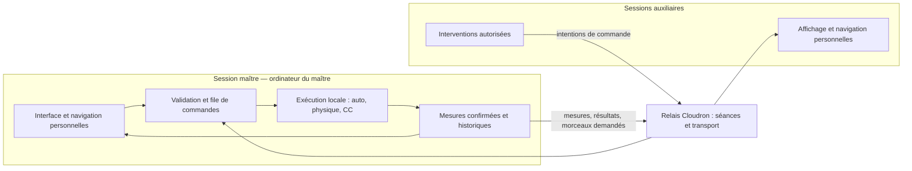

# Centurion — partage d’une simulation entre plusieurs ordinateurs

Note de proposition du 17 octobre 2026, issue de la lecture du code local. Cette note conserve le plan initial ; la version 0.3.0 réalise désormais le partage des interfaces, du pilotage, des documents et des historiques. L’état livré est décrit dans CONCEPTION.md et DEMARRAGE-MULTI.md. Les droits réglables, verrous exclusifs et Worker ci-dessous restent des perspectives. Le contrôle actuel d’édition repose sur les révisions avec refus des conflits.

Mise à jour de la préparation : le relais peut être hébergé sur le serveur Vultr déjà disponible. Cloudron reste une option. Voir [le comparatif d’hébergement](PARTAGE-HEBERGEMENT.md) et [l’état du premier lot](DEMARRAGE-MULTI.md).

## 1. Décisions structurantes

Centurion conserve son mode individuel autonome, y compris depuis un dossier local. Le partage est une fonction optionnelle activée explicitement ; une panne ou l’absence du relais ne doit jamais empêcher l’utilisation individuelle ni arrêter le calcul du maître.

Une seule session navigateur, le **maître**, possède le modèle autoritaire et exécute la physique, les régulations, les protections, les programmes de charge et la conduite automatique. Elle décide de l’horloge et applique toutes les interventions. Les **auxiliaires** affichent ses données confirmées et lui proposent des commandes autorisées.

Le serveur Cloudron est un relais de messages par séance. Il vérifie l’accès à la séance et l’identité de la connexion maître ; il ne charge aucun moteur Centurion, n’évalue aucun graphe et ne décide d’aucune conséquence physique. Une instance et une mémoire éphémère suffisent pour commencer ; aucune base de données n’est nécessaire.

Chaque participant conserve sa navigation : onglet, synoptique, GV, zoom, courbes et lecture temporelle. Les deux seuls rôles sont maître et auxiliaire. Une liste de fonctions ouvertes, réglée par le maître et commune à tous les auxiliaires, suffit.

## 2. Diagnostic de l’existant

| Point examiné | Constat dans le code | Conséquence pour le partage |
| --- | --- | --- |
| `centurion-engine.js` | Module sans DOM, export navigateur/CommonJS ; modèle `{state, controls}` modifié sur place | Conserver une seule instance active chez le maître. Aucun portage serveur nécessaire. |
| `centurion-app.js:40` | Modèle, horloge, commandes et variables de navigation réunis dans la même fermeture | Introduire une frontière entre exécution autoritaire et affichage local. |
| `centurion-app.js:1096` | `advanceControlledStep` exécute la conduite auto, puis `E.step(model, 0.1)`, puis les deux CC actifs | Préserver cet ordre ; ajouter les interventions extérieures à une frontière de pas complète. |
| `centurion-app.js:1078` | `dispatchEditor` appelle directement `CenturionCC.receive` si possible, sinon utilise `postMessage` | Garder initialement ce raccordement uniquement entre documents locaux du maître. |
| `centurion-app.js:1188` | `applyEditorOutputs` applique la régulation avant les protections | Conserver les priorités ; une commande auxiliaire n’est jamais une sortie CC. |
| `centurion-app.js:1415` et suivantes | De nombreux événements DOM écrivent directement dans `model.controls` ou appellent le moteur | Regrouper ces mutations dans une interface de commandes avant d’ouvrir les commandes distantes. |
| `centurion-auto.js:431` | `executeCommand`, `executeActions` et `actionCatalog` couvrent déjà beaucoup de commandes et de règles d’admissibilité | Réutiliser et compléter ce catalogue ; ne pas créer un deuxième arbitrage distant. |
| `centurion-cc-regul.html:6436` | Interface `connect`, `tick`, `save`, `validate`, `restore` ; évaluateur et mémoires dynamiques dans l’éditeur HTML | Le partage initial peut conserver les évaluateurs du maître. L’édition distante exige une commande de graphe distincte de la restauration complète. |
| `centurion-state.js:164` et `:292` | Sauvegarde validée et migrée, incluant modèle, historiques, graphes, mémoires, affichage et conduite auto | Conserver ce format de fichier ; créer un protocole réseau séparé. |
| `centurion-svg-bridge.js` | Les SVG consomment déjà des instantanés par messages ; navigation et zoom sont locaux | Réutiliser la projection instrumentale et la navigation existantes. |
| `centurion-history.js:232` | Le composant graphique lit encore le modèle et ses historiques via `getModel` | Prévoir un fournisseur de mesures et d’historiques utilisable en mode local comme auxiliaire. |
| `centurion-app.js:1658` | Calcul entraîné par `requestAnimationFrame` ; accumulation et paquets bornés | Un onglet maître masqué n’est pas un hôte fiable en l’état. Traiter cette limite explicitement. |

L’application limite actuellement un paquet à 150 sous-pas et rend aussi la main après environ 30 ms de calcul. Le delta réel est plafonné à 0,15 s, l’accumulation à 30 s simulées, avec une réduction supplémentaire lorsque la limite de 150 pas est atteinte. L’objectif ×200 est donc une vitesse demandée, dont la tenue dépend du coût du modèle ; le partage doit mesurer la vitesse effectivement obtenue.

Le chemin `postMessage` local attend les réponses des CC avant le pas suivant. Cette attente locale protège la cohérence du calcul : elle ne doit jamais devenir une attente d’auxiliaire ou de serveur.

Mesure ponctuelle sur le modèle nominal initial avec Node.js : `historyPoint` contient 396 valeurs numériques et son JSON occupe 3 620 octets ; 28 800 points de cette taille représentent environ 99,4 Mio. `instrumentSnapshot` occupe 10 724 octets. Ces chiffres décrivent ce cas nominal, pas une taille maximale ni un coût CPU mesuré en navigateur.

Écart documentaire à conserver en tête : `docs/CONCEPTION.md` décrit CC-PROTECT comme actif au démarrage, alors que le code local initialise `regulationActive` et `protectionActive` à `false`. Le chantier de partage doit prendre le comportement du code comme référence et traiter toute correction de ce défaut de concordance séparément.

## 3. Architecture proposée

Les auxiliaires ne créent pas de simulation active. Ils peuvent employer les fonctions pures de formatage ou de projection nécessaires à leur interface, mais n’appellent ni `E.step`, ni les séquences, ni l’évaluation dynamique CC. Le démarrage des iframes et leurs sauvegardes automatiques locales doivent respecter ce mode : un ancien graphe du navigateur auxiliaire ne doit jamais remplacer le graphe de séance.

Découpage limité proposé :

| Élément | Responsabilité |
| --- | --- |
| `centurion-commands.js` | Catalogue commun, types, bornes, règles métier et application des commandes ; partagé avec la conduite auto. |
| `centurion-session.js` | Session locale autoritaire : modèle, file de commandes, limites de pas, versions, résultats et instantanés. Aucun accès réseau obligatoire. |
| `centurion-share.js` | Mode maître/auxiliaire, connexion optionnelle, resynchronisation, messages, état de connexion et droits communs. |
| Relais dans un répertoire séparé, par exemple `partage/relay/` | Petit service Node.js/Socket.IO et paquet Cloudron ; dépendances et déploiement distincts de l’application statique. |

La projection d’affichage est définie explicitement dans la session ou un petit module dédié si sa taille le justifie. Elle fournit les mesures communes aux quatre GV et aux quatre boucles, les profils cœur nécessaires, les commandes confirmées, les alarmes, le programme de charge et la conduite auto. `instrumentSnapshot` fournit une bonne base, mais ne couvre pas à lui seul toutes les vues actuelles, notamment le cœur et les paramètres.

Les fonctions de rendu consomment cette projection ; le choix du GV et du synoptique se fait chez chaque participant. Il faut copier les données à la frontière de publication : l’instantané existant contient encore certaines références partagées, notamment `inventory`.

## 4. Commandes : une seule autorité et une confirmation explicite

### Point d’entrée commun

Les commandes du maître et des auxiliaires passent par le même point d’entrée métier. La conduite auto emploie le même catalogue et les mêmes règles, tout en conservant son emplacement actuel avant le pas physique. Les autorisations réseau ne s’appliquent qu’aux intentions provenant des auxiliaires.

Pour chaque intervention distante, le maître :

1. vérifie séance, génération courante, connexion auxiliaire encore valable, droit commun et fraîcheur de la demande ;
2. vérifie identifiant, type, bornes, cible et admissibilité dans le contexte courant ;
3. recherche un résultat déjà connu pour cet identifiant ;
4. place la demande dans une file bornée puis revalide les conditions changeantes au moment d’appliquer ;
5. applique la demande à une frontière de pas, une fois les réponses CC locales du pas précédent réunies ;
6. publie le résultat d’application et les commandes effectivement retenues, avec numéro d’ordre et temps simulé.

En pause, la même file est traitée à un point d’arrêt cohérent, sans avancer artificiellement de 0,1 s. Les actions « programmer un initiateur » et « lancer une séquence » confirment d’abord leur programmation ; leur déclenchement ou leur fin reste un événement distinct.

L’ordre de référence devient : interventions acceptées à la frontière → conduite auto → physique 0,1 s → CC-Régul → CC-Protect → état complet publiable. Les priorités actuelles des programmes et protections restent applicables : une intention manuelle peut être refusée ou reprise ensuite par un automatisme déjà actif. L’interface distingue la consigne acceptée de la réponse physique réalisée.

Deux interventions concurrentes sont départagées par l’ordre donné par le maître, sans synchroniser les horloges des ordinateurs. Pour une même consigne ordinaire, la dernière commande appliquée fixe la nouvelle demande, sous réserve des priorités métier. Les changements de mode sont validés dans cet ordre. Les mises à jour d’un curseur peuvent être regroupées avant émission ; les ordres ponctuels et changements de mode ne sont pas fusionnés.

### Identifiants et reprises

Le protocole comporte une version et une révision applicative compatible. Chaque message porte un identifiant de séance et une génération de simulation (`epoch`), renouvelée lors d’une réinitialisation ou d’un chargement réussi. On distingue le numéro de pas physique, le numéro de publication et le numéro d’application des commandes, car des commandes peuvent être appliquées en pause.

Chaque connexion auxiliaire reçoit une génération de connexion et produit des identifiants de commande uniques. Le maître conserve les résultats récents et les bornes de séquence déjà traitées : l’expiration du détail d’un résultat ne rend pas une ancienne commande exécutable à nouveau. Une répétition pendant la même connexion renvoie le résultat connu, sans réapplication ; un identifiant réutilisé avec un contenu différent est rejeté.

L’accusé utile provient du maître après application. L’accusé de réception du relais ne prouve pas que le réacteur a été modifié. Si une coupure laisse le résultat incertain, l’auxiliaire affiche « résultat à vérifier », reprend un instantané et peut demander le reçu connu ; il ne relance pas automatiquement l’intervention.

Déconnexion ou changement de génération invalident les anciennes demandes non appliquées. Les commandes ne sont jamais mises en réserve pour une reconnexion. Le relais ne conserve pas de file d’interventions vers un maître absent ; le maître refuse les demandes d’une ancienne connexion et les commandes trop anciennes selon une durée réelle bornée. Cette fraîcheur peut s’appuyer sur le dernier état du maître observé, sans faire confiance à l’horloge civile de l’auxiliaire. Un changement de génération purge aussi les verrous, les brouillons en attente d’application et les demandes d’historique.

La garantie visée est une application au plus une fois dans une session maître vivante, avec reçus et déduplication. Elle ne promet pas une transaction durable après destruction du navigateur maître. Une nouvelle session maître ouvre une nouvelle autorité ; elle ne rejoue pas les anciennes demandes.

### Fonctions ouvertes aux auxiliaires

Proposition initiale de cases à cocher, commune à tous : commandes manuelles ; programmes de charge ; initiateurs et défaillances ; conduite auto ; CC-Régul ; CC-Protect ; paramètres sélectionnés. L’activation/désactivation d’un CC appartient à sa famille. Les paramètres sont énumérés explicitement avec leurs bornes ; aucune commande générique « écrire un chemin du modèle » n’est exposée.

Horloge, vitesse, réinitialisation, chargement d’une sauvegarde et réglage de cette liste restent au maître dans la première version. Les seuils du tableau de surveillance peuvent rester des préférences locales ; les seuils qui influencent réellement les protections appartiennent aux paramètres partagés. La navigation et la lecture des historiques sont libres.

## 5. Flux courant, instantanés et historiques

### Mesures courantes

Commencer à **5 publications par seconde réelle**, avec une projection courante autonome de taille bornée. On peut omettre une publication et consommer la suivante sans reconstruire une chaîne de différences. Les configurations et graphes, versionnés, voyagent à l’entrée dans la séance puis à leur changement ; l’historique complet ne figure dans aucun tick.

À ×200, 200 secondes simulées produisent environ 200 points historiques par seconde réelle, alors que le flux courant n’en montre que cinq instants. Les valeurs intermédiaires des courbes proviennent des morceaux d’historique, pas des cinq instantanés. Les changements d’alarme, fins de partie, résultats de commande et révisions de configuration sont des messages distincts des mesures remplaçables.

Une projection nominale de 10,7 ko publiée à 5 Hz représente environ 54 ko/s avant protocole, profils supplémentaires et compression ; le relais multiplie ensuite son envoi par le nombre d’auxiliaires. Mesurer sur les cas réels avant de choisir un encodage binaire. Il faut aussi mesurer la sérialisation et la copie côté maître : une émission asynchrone ne supprime pas leur coût CPU.

La publication s’effectue après un pas complet et sans attendre de réponse réseau. Le maître et le relais conservent au plus les dernières mesures à envoyer, bornent les files par destinataire et abandonnent les anciennes publications sous pression. Un auxiliaire trop lent passe en resynchronisation ou est déconnecté. Les commandes et leurs résultats gardent un canal logique fiable et des files bornées ; les transferts d’historique sont interrompus ou limités avant de gêner les commandes.

### Entrée et resynchronisation

À l’arrivée : vérifier versions et accès → recevoir un instantané d’affichage avec son numéro de publication → recevoir les configurations à leurs révisions annoncées → reprendre le flux à un numéro ultérieur. Le client ignore les messages d’une ancienne génération et les publications plus anciennes que celles déjà reçues.

Pendant cet échange, conserver seulement la publication la plus récente ou demander un nouvel instantané si les versions ne concordent plus. Une perte de mesure courante ne nécessite pas de reprise complète ; un trou dans les configurations, les événements ou les morceaux demandés est réparé explicitement. Chaque participant conserve son propre affichage durant la reprise ; le maître ne lui impose pas son `stateUi()`.

### Historiques à la demande

Le fournisseur d’historique accepte un intervalle simulé, des variables et une résolution adaptée au dessin. Réponse proposée : identifiant de requête, génération, intervalle réellement disponible, ordre du catalogue, numéros de morceaux et numéros d’échantillons. Le maître copie chaque morceau dans une limite de travail donnée et précise si des points ont quitté la fenêtre conservée entre-temps.

Commencer avec une limite explicite, par exemple 256 échantillons et 64 ko encodés par morceau, à ajuster par mesure ; limiter aussi variables, requêtes simultanées et débit par participant. Le mode exact transmet les échantillons réels ; un mode d’aperçu réduit doit préserver les extrema utiles. Le curseur détaillé redemande les points exacts et ne présente pas un point réduit comme une mesure exacte.

Les auxiliaires maintiennent un cache borné des périodes consultées. Une période absente ou en chargement est signalée ; elle n’est jamais complétée par une simulation locale ni par des zéros. Le diagramme P–T peut réutiliser son format réduit existant de cinq valeurs par point. Les nouvelles requêtes annulent celles devenues inutiles après une navigation rapide.

## 6. Diagrammes : un seul éditeur, exécution toujours chez le maître

Un verrou exclusif par document — CC-Régul, CC-Protect, conduite auto — s’applique au maître comme aux auxiliaires. Le maître attribue le verrou, peut le reprendre et en diffuse le propriétaire. Les verrous expirent après perte de connexion ou d’activité confirmée, en temps réel, indépendamment de la vitesse de simulation.

Pour une première version : l’éditeur autorisé travaille sur un brouillon et utilise **Appliquer**. La proposition contient le document et sa révision de départ. Le maître vérifie le verrou, la révision et le graphe, puis remplace le document à une frontière de pas et diffuse la nouvelle révision. Les autres participants consultent la version confirmée avec leurs propres sélection, zoom et position de canevas.

Cela exige de séparer explicitement brouillon d’édition et graphe exécuté dans l’éditeur du maître : l’existant modifie encore son graphe actif directement. Le même trajet de proposition doit donc être raccordé aux modifications locales du maître, et pas seulement aux modifications distantes. Le verrou doit être pris avant modification ; le retour arrière et l’import d’un document suivent la même règle.

Les changements distants ne passent **pas** par `centurion-editor-restore` : cette commande transporte aussi les mémoires CC, les dernières valeurs, l’état actif et le viewport. Ajouter une interface « valider/remplacer le graphe » qui n’accepte que le document. Conserver les mémoires des blocs inchangés suivant les règles de l’éditeur ; définir et tester l’initialisation des blocs ajoutés ou modifiés. Une sortie calculée par l’auxiliaire n’est jamais admise comme commande du réacteur.

Pour montrer les valeurs des blocs dynamiques, diffuser à cadence modérée les diagnostics et signaux du maître pour les diagrammes consultés. Ne pas réévaluer localement les filtres ou intégrateurs à partir de mesures reçues à 5 Hz.

La conduite auto garde sa règle actuelle : interrompre la séquence avant de modifier son graphe ; le remplacement accepté invalide l’ancienne progression selon cette règle. Les imports et brouillons auxiliaires restent distincts des sauvegardes automatiques individuelles. Une coupure peut conserver un brouillon local à récupérer manuellement, mais ne le soumet jamais automatiquement à la reconnexion.

## 7. Horloge, onglet masqué et indisponibilité

Le dessin peut rester sur `requestAnimationFrame` ; l’exécution ne doit plus en dépendre pour une séance destinée à durer en arrière-plan. Remplacer uniquement le réveil par un timer ne donne pas cette garantie, et placer uniquement la physique dans un Worker laisse les CC dépendre de la page et de ses iframes.

Étape intermédiaire acceptable pour le prototype : exécution actuelle avec maître visible, détection de page masquée, indication explicite et état de progression surveillé par les auxiliaires. Il faut distinguer « simulation en pause », « connexion perdue » et « maître connecté mais calcul sans progression ». Les battements de présence et numéros de pas servent à ce diagnostic ; un battement réseau seul ne prouve pas que le calcul progresse.

Pour une version utilisable en arrière-plan, extraire l’évaluateur CC et ses mémoires dans un module sans DOM, puis déplacer **ensemble** l’ordonnanceur, le moteur, les deux évaluateurs et la conduite auto dans un Worker local au maître. Les éditeurs deviennent des vues et des producteurs de documents. Les commandes et instantanés franchissent seulement la frontière locale page/Worker ; aucun aller-retour par le serveur ne participe à un pas physique. Le transfert des événements programmés et des décomptes réels fait partie de cette extraction.

Cette migration doit démontrer la parité des résultats et des sauvegardes avant activation. Le mode individuel depuis `file://` garde un adaptateur local de repli si le Worker ne peut pas être chargé ; les mêmes modules de calcul servent aux deux chemins. La première version partagée peut être limitée à un lancement HTTPS explicitement identifié dans l’interface.

Un Worker améliore la séparation du calcul et du dessin, mais ne garantit ni l’exécution pendant la veille du PC, ni la survie d’une page gelée, détruite ou d’un navigateur fermé. Après une suspension, ne pas rattraper aveuglément toute la durée écoulée : arrêter l’accumulation, signaler l’interruption et reprendre selon une règle explicite ; revalider ou annuler les décomptes d’initiateurs encore pendants.

En cas de disparition du maître, les auxiliaires gardent le dernier état confirmé marqué périmé et ne peuvent plus intervenir. Aucune promotion automatique. Si le même maître vivant revient, il reprend explicitement sa connexion autoritaire et republie un instantané ; le relais invalide l’ancienne connexion. Un rechargement de page perdant le modèle ne reprend pas silencieusement la séance. Le retour à une simulation individuelle chez un auxiliaire est une action explicite et ouvre une simulation indépendante.

## 8. Relais et hébergement

Choix de départ recommandé : **Socket.IO sur WebSocket**, une instance Node.js et une room par séance sur Cloudron. Socket.IO apporte les groupes et l’infrastructure de connexion ; les garanties métier restent dans le protocole Centurion. Configurer et tester le transport retenu, sans confondre Socket.IO avec le protocole WebSocket natif.

Le relais gère identifiant de séance, connexion maître unique, participants, justificatifs d’accès, présence et routage. Le lien d’invitation donne accès comme auxiliaire ; la capacité de reconnexion du maître reste privée et n’est jamais incluse dans ce lien. Les liens peuvent être révoqués en fermant ou renouvelant la séance, sans comptes obligatoires ni nouvelles catégories d’utilisateurs. Ne pas journaliser les capacités ; si elles figurent dans un lien, préférer un fragment lu par le client puis envoyé dans le message d’authentification.

Valider schéma, taille et cadence des messages au relais, puis règles métier et permissions au maître. Les auxiliaires ne peuvent ni publier l’état autoritaire ni envoyer un accusé à sa place. Vérifier la source des messages des iframes locales : `handleEditorMessage` ne doit jamais devenir un point d’entrée direct pour les données du réseau. Sur HTTPS, employer la connexion chiffrée et autoriser explicitement l’origine de l’application statique ; la compatibilité `file://` individuelle n’impose pas d’ouvrir le relais à toutes les origines.

Un paquet Cloudron séparé contient le service, ses dépendances verrouillées, `Dockerfile`, `CloudronManifest.json`, démarrage et contrôle de santé. Aucun moteur ni fichier d’état utilisateur n’est nécessaire au serveur. Les séances en mémoire expirent ; un redémarrage du relais les interrompt, le maître continue localement et peut créer une nouvelle séance. Le déploiement n’exige pas de Redis, de TURN ou de base de données dans ce périmètre.

Le client réseau est livré avec le projet et chargé à l’activation du partage, sans CDN requis pour le mode individuel. L’application statique peut rester sur GitHub Pages. Le déploiement partagé doit annoncer sa version et refuser clairement un client incompatible plutôt que mélanger deux catalogues de mesures ou de commandes.

Attention à Socket.IO : les événements émis pendant une déconnexion sont normalement conservés côté client. Le connecteur Centurion doit refuser ces émissions, désactiver les reprises automatiques des interventions et purger ses demandes invalidées. Les mesures courantes peuvent utiliser des événements volatils ; les résultats des commandes sont des messages distincts.

## 9. Plan progressif et critères de passage

| Lot | Travail concret | Résultat vérifiable avant de continuer |
| --- | --- | --- |
| 1. Frontières locales | Extraire le catalogue/application des commandes, isoler la session autoritaire, fournir une projection d’affichage et un accès aux historiques. Conserver les raccordements CC actuels. | Le mode individuel reste autonome ; commandes, priorités, pas CC et sauvegardes produisent les mêmes résultats sur scénarios de référence. Aucun réseau nécessaire. |
| 2. Auxiliaires en lecture | Relais de développement, création/invitation, versions, instantané initial, mesures 5 Hz, navigation personnelle et historiques par morceaux. | Un maître et deux auxiliaires affichent le même réacteur avec des GV et courbes différents. Aucun pas calculé par les auxiliaires. Coupure du relais sans arrêt du maître. |
| 3. Interventions | File autoritaire, déduplication, reçus, fraîcheur, invalidation après coupure/reset et liste commune de fonctions. Ouvrir d’abord les commandes manuelles, puis les autres familles déjà couvertes par le catalogue. | Demande répétée appliquée une seule fois ; valeurs refusées expliquées ; changement de génération et reconnexion sans rejeu ; commandes également applicables en pause. |
| 4. Diagrammes et conduite | Verrous par document, brouillons distincts, validation et application versionnées, signaux CC confirmés, imports et autosauvegardes adaptés. | Deux participants ne peuvent pas modifier simultanément un même document ; graphe périmé refusé ; mémoires dynamiques conservées selon les règles ; séquence en cours protégée. |
| 5. Exécution locale en arrière-plan | Extraire l’évaluateur CC ; Worker local avec physique, CC et auto ; repli individuel ; détection suspension/retard. | Parité sur transitoires et mémoires ; vérification dans les navigateurs visés, maître masqué et auxiliaire actif. Aucune dépendance au réseau entre pas et limite veille/fermeture clairement indiquée. |
| 6. Pilote Cloudron | Paquet dédié, essais sur plusieurs ordinateurs, limites de charge, reconnexions et information de séance. | Mode solo réseau coupé ; essais ×1 et ×200 ; participant lent sans accumulation ni ralentissement collectif ; maître fermé sans bascule ; procédure de déploiement et retour arrière documentées. |

Les lots 2 à 4 peuvent être validés avec un maître au premier plan. Le lot 5 est un préalable à l’annonce d’un fonctionnement en arrière-plan ; si cet usage est indispensable dès le premier pilote, avancer ce lot avant le lot 3. Le premier lot utile est donc une refactorisation locale limitée, suivie d’un partage en lecture seule.

### Vérifications ciblées à prévoir pendant l’implémentation

Réemployer les tests moteur, CC, conduite auto et sauvegarde ; certains tests extraient des fonctions de `centurion-app.js` ou de l’HTML par découpage de texte. Leur raccordement devra évoluer avec les extractions, en gardant les assertions métier.

Les vérifications nouvelles doivent couvrir les risques propres au partage :

- même séquence de commandes et même nombre de pas → mêmes grandeurs physiques, mémoires CC et progression auto, en individuel et en maître partagé ;
- deux auxiliaires avec navigation indépendante, lecture temporelle différente et commandes concurrentes ;
- commande répétée, reçu perdu, file pleine, changement de permissions entre réception et application, ancienne connexion et ancienne génération ;
- auxiliaire lent, gros historique, requêtes annulées et reconnexion au milieu d’un transfert, avec mémoire et débit bornés ;
- pause, chargement avec validation/retour arrière, réinitialisation et commandes reçues pendant une sauvegarde ;
- verrou perdu, brouillon obsolète, reprise du verrou et import sans écrasement des mémoires ou du viewport des autres ;
- onglet maître masqué, gel/suspension, fermeture, panne et redémarrage du relais, sans promotion implicite ;
- vitesse réelle atteinte, coût de sérialisation, temps de traitement d’une commande et mémoire aux vitesses ×1 et ×200, sur cas nominal et transitoires coûteux.

Un objectif de confort, par exemple une commande confirmée en moins d’une seconde sur le réseau du pilote, sera mesuré plutôt que promis. Le protocole n’essaie pas de faire arriver tous les participants au même pas par une barrière réseau.

## 10. Périmètre de cette analyse et publication future

Cette note décrit une proposition et ne déploie aucun relais. Le premier adaptateur local de commandes est préparé séparément, sans être chargé par la page actuelle. Elle est conservée à part de la documentation qui décrit le comportement déjà implémenté. Son intégration éventuelle au site documentaire pourra passer par le générateur, lorsqu’elle sera destinée à publication.

Vérification de l’existant effectuée pendant cet audit : `node --test simulateur/tests/centurion-cc.test.js simulateur/tests/centurion-auto-actions.test.js simulateur/tests/centurion-state.test.js` — 42 tests réussis, aucun échec. Cela valide ces comportements locaux existants ; ce relevé historique précède les tests de partage ajoutés en 0.3.0. Les références de fichiers, numéros de ligne et la structure Markdown de cette note ont aussi été contrôlés.

Le checkout historique de Centurion contient de nombreuses modifications déjà publiées et n’a pas servi de source à cette copie. Ce nouveau dépôt a été cloné depuis `vcnamgn/science005` au commit public vérifié `ced5ea094b809def2d713a706ca6952b4ccd0492`. Le remote `origin` vise `vcnamgn/centurionmulti` ; `upstream` conserve la source en lecture, avec son URL de push désactivée. Les évolutions du partage se font sur une branche dédiée.

## 11. Références techniques vérifiées

- [Socket.IO — rooms](https://socket.io/docs/v4/rooms/) : diffusion par groupes et adhésions conservées en mémoire.
- [Socket.IO — garanties de livraison](https://socket.io/docs/v4/delivery-guarantees/) : ordre de livraison et garanties supplémentaires à construire dans l’application.
- [Socket.IO — comportement hors connexion](https://socket.io/docs/v4/client-offline-behavior/) : mise en réserve par défaut et émissions volatiles.
- [Cloudron — tutoriel de packaging](https://docs.cloudron.io/packaging/tutorial/) : conteneur, manifeste, installation et mise à jour d’une application dédiée.
- [MDN — visibilité de page](https://developer.mozilla.org/en-US/docs/Web/API/Page_Visibility_API) : suspension de `requestAnimationFrame` et limitation des timers d’onglets masqués.
- [MDN — WebSocket](https://developer.mozilla.org/en-US/docs/Web/API/WebSocket) : absence de régulation automatique du flux dans l’API WebSocket classique.
- [Chrome — cycle de vie des pages](https://developer.chrome.com/docs/web-platform/page-lifecycle-api) : états gelé et détruit à prendre en compte.
